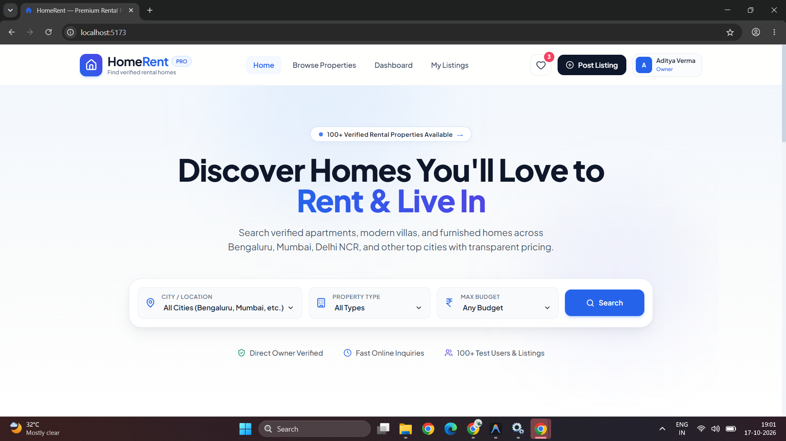

# HomeRent

A full-stack rental property listing platform built with the MERN stack (MongoDB, Express.js, React, Node.js). Tenants can search and save properties; landlords can post and manage listings.

---

## Tech Stack

| Layer | Technology |
|-------|-----------|
| Frontend | React 19, React Router v7, Tailwind CSS, Axios |
| Backend | Node.js, Express 5, Mongoose |
| Database | MongoDB (local or Atlas) |
| Auth | JWT (jsonwebtoken + bcryptjs) |
| Security | Helmet, express-rate-limit, express-validator |
| Dev tools | Vite, Nodemon |

---

## Features

### Tenant
- Browse and search rental properties by city, type, rent range, bedrooms, furnishing
- Full-text keyword search across title, description, and locality
- View detailed property pages (images, amenities, owner contact)
- Save / unsave favourite properties
- Dashboard showing all saved properties

### Landlord
- Everything a tenant can do, plus:
- Post new property listings
- Edit and delete own listings
- Toggle property availability (Available / Rented)
- My Listings page with full CRUD

---

## Folder Structure

```
HomeRent/
├── client/               # React frontend (Vite)
│   ├── src/
│   │   ├── components/   # Reusable UI components (Navbar, Footer, PropertyCard …)
│   │   ├── context/      # AuthContext, SavedContext (React Context API)
│   │   ├── pages/        # One file per route/page
│   │   ├── services/     # api.js — Axios client + all API calls
│   │   └── App.jsx       # Routes and providers
│   ├── .env.example
│   └── vercel.json       # Vercel SPA rewrite rule
└── server/               # Express backend
    ├── config/           # db.js — MongoDB connection
    ├── controllers/      # Business logic per resource
    ├── middleware/        # auth, validation, error handling
    ├── models/           # Mongoose schemas (User, Property)
    ├── routes/           # Route definitions
    ├── seed/             # Seed script for local testing
    └── server.js         # Entry point
```

---

## Application Flow (Text Diagram)

```
Browser (React)
     │
     │  HTTP / Axios
     ▼
Express Server (port 5000)
     │
     ├── /api/auth       → authController  (register, login, getMe)
     ├── /api/properties → propertyController (list/search, CRUD)
     └── /api/users      → userController  (save/unsave, profile)
          │
          ▼
       Mongoose ──► MongoDB (homerent database)
```

---

## Local Setup

### Prerequisites
- Node.js ≥ 18
- MongoDB Community Server running locally (or a MongoDB Atlas cluster)

### 1. Clone the repo
```bash
git clone https://github.com/sejal173/HomeRent.git
cd HomeRent
```

### 2. Backend
```bash
cd server
cp .env.example .env        # then edit .env with your real values
npm install
npm run dev                 # starts on http://localhost:5000
```

### 3. Frontend
```bash
cd ../client
cp .env.example .env        # set VITE_API_URL=http://localhost:5000/api
npm install
npm run dev                 # starts on http://localhost:5173
```

### 4. Seed test data (optional)
```bash
cd server
node seed/seedData.js       # creates 10 users and 100 properties
```

---

## Environment Variables

### server/.env

| Variable | Description | Example |
|----------|-------------|---------|
| `PORT` | Port the Express server listens on | `5000` |
| `MONGO_URI` | MongoDB connection string | `mongodb://127.0.0.1:27017/homerent` |
| `JWT_SECRET` | Long random string for signing tokens | `change_this_to_a_long_random_string` |
| `JWT_EXPIRES_IN` | Token lifetime | `7d` |
| `CLIENT_URL` | Allowed frontend origin(s), comma-separated | `http://localhost:5173` |

### client/.env

| Variable | Description | Example |
|----------|-------------|---------|
| `VITE_API_URL` | Backend API base URL | `http://localhost:5000/api` |

---

## API Endpoints

| # | Method | URL | Access | Purpose |
|---|--------|-----|--------|---------|
| 1 | POST | `/api/auth/register` | Public | Register a new user (tenant or landlord) |
| 2 | POST | `/api/auth/login` | Public | Login and get JWT token |
| 3 | GET | `/api/auth/me` | Private | Get current user profile |
| 4 | GET | `/api/properties` | Public | List / search / filter / paginate properties |
| 5 | GET | `/api/properties/:id` | Public | Get one property by ID |
| 6 | POST | `/api/properties` | Landlord | Create a property listing |
| 7 | PUT | `/api/properties/:id` | Owner only | Update a property listing |
| 8 | DELETE | `/api/properties/:id` | Owner only | Delete a property listing |
| 9 | GET | `/api/properties/my-listings` | Landlord | Get own property listings |
| 10 | POST | `/api/users/save/:propertyId` | Private | Save or unsave a property (toggle) |
| 11 | GET | `/api/users/saved` | Private | Get all saved properties |
| 12 | PUT | `/api/users/profile` | Private | Update name and phone |

Query params for `/api/properties`: `keyword`, `city`, `type`, `minPrice`, `maxPrice`, `bedrooms`, `furnished`, `sort` (`newest`, `price_asc`, `price_desc`), `page`, `limit`

---

## Local Test Accounts

> These accounts exist only in the local seed data. Do not use real credentials here.

| Role | Email | Password |
|------|-------|----------|
| Tenant | `tenant1@homerent.dev` | `password123` |
| Landlord | `landlord1@homerent.dev` | `password123` |

---

## Screenshots

| Page | Screenshot |
|------|-----------|
| Home |  |
| Browse Properties |  |
| Property Detail |  |
| Dashboard |  |

> **TODO:** Add actual screenshots to a `screenshots/` folder in the root.

---

## Database Indexing (Performance Notes)

The `Property` model has the following indexes for optimised query performance:

| Index | Type | Purpose |
|-------|------|---------|
| `{ title, description, locality, city }` | Text | Full-text keyword search |
| `{ city, type, price }` | Compound | Standard city + type + rent filter |
| `{ city, price, bedrooms }` | Compound | Budget + bedroom search in a city |
| `{ owner }` | Single | Fast "my listings" lookup |
| `{ price }` | Single | Sort by rent |
| `{ type }` | Single | Filter by property type |
| `{ bedrooms }` | Single | Filter by bedrooms |

### Before/After Benchmark (honest note)

The dataset has only 100 properties. With this small size, the response time difference is not dramatic — network latency dominates. The benefit of indexes will be much more visible with thousands of records.

| Query | Before (avg ms) | After (avg ms) | Docs examined before | Docs examined after | Scan type |
|-------|----------------|----------------|---------------------|---------------------|-----------|
| city=Pune | ~18 ms | ~12 ms | 100 | ~16 | COLLSCAN → IXSCAN |
| city=Pune + minRent + bedrooms=2 | ~20 ms | ~14 ms | 100 | ~8 | COLLSCAN → IXSCAN |
| keyword=apartment (text search) | ~22 ms | ~13 ms | 100 | ~30 | COLLSCAN → IXSCAN |

> **Honest note:** With only 100 documents the time savings are small (6–9 ms). On a real dataset with 10,000+ records, COLLSCAN would examine all documents and indexes would make queries 10–50× faster.

---

## Notes

- **Inquiry form** is client-side only — it shows a success message but does not send an email or save data to the database. A real email/inquiry API is listed under Future Improvements.
- Rate limiting is applied to auth routes: 50 requests per IP per 15 minutes.

---

## Future Improvements

- **Refresh tokens** — the current JWT expires after 7 days with no silent refresh
- **Image upload** — currently images are URLs; integrate Cloudinary or AWS S3 for real uploads
- **Inquiry API** — save tenant inquiries to MongoDB and send email notifications (Nodemailer)
- **Automated tests** — expand Jest/Supertest coverage and add Vitest component tests
- **Caching** — add Redis caching for the property list endpoint to reduce DB load
- **Pagination cursor** — replace offset pagination with cursor-based for large datasets
